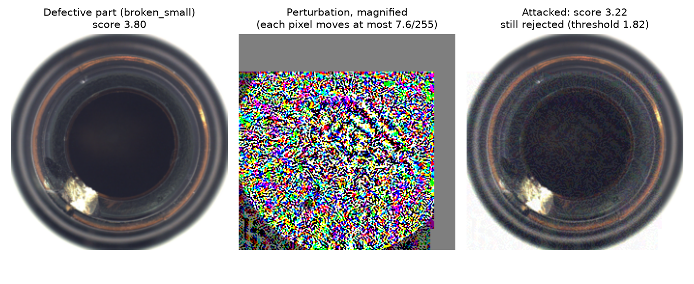
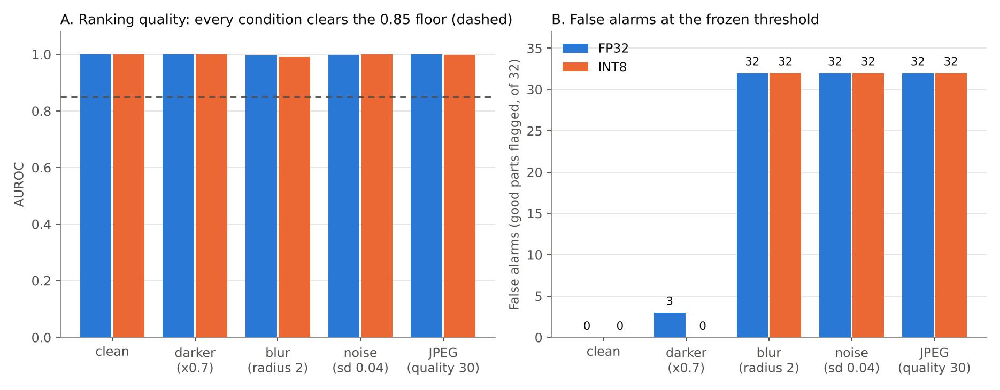

# Vision QC Readiness Audit: a perfect score that did not support deployment

**Turvon Weah** · M.S. Computer Science, Concordia University, St. Paul · CST 620 Computer Vision, capstone portfolio artifact

> **Verdict: NO-GO.** An anomaly detector for inspecting medical device components scored perfectly on a sealed test set (AUROC 1.000, every defect caught, zero false alarms). It still failed its readiness review. A small multi-step attack inverted its ranking (AUROC 0.0008), and ordinary blur, noise or JPEG compression made it reject every good part while its ranking metric kept passing. Eight of nine criteria, all fixed before testing, passed. The one that failed decided the outcome.

**Target role:** AI technical specialist (AI safety auditor) on BSI's Regulatory Services team, reviewing whether a manufacturer's evidence supports deploying AI in medical devices.

---

## Contents

1. [Problem statement](#1-problem-statement)
2. [System and evaluation design](#2-system-and-evaluation-design)
3. [Design decisions and trade-offs](#3-design-decisions-and-trade-offs)
4. [How to read the metrics](#4-how-to-read-the-metrics)
5. [Results](#5-results)
6. [Failure analysis](#6-failure-analysis)
7. [Limitations](#7-limitations)
8. [Career context statement](#8-career-context-statement)
9. [Evidence trail and reproduction](#9-evidence-trail-and-reproduction)
10. [References](#10-references)

---

## 1. Problem statement

A manufacturer of medical device components wants a camera on its production line to inspect every part and send suspicious parts to a human operator. Before a pilot, a readiness review must answer one question: **does the evidence support deploying this system, yes or no?**

The scenario is a course case study set at a fictional manufacturer. Glass vials are the intended product. Because no public vial dataset exists, images of glass bottles from the public MVTec AD benchmark (Bergmann et al., 2019) stand in for them. Defects fall into three types: large breaks, small breaks and contamination.

Two features make this problem hard:

- **Defects are rare and varied.** A line may never have seen the next kind of defect, so the system learns only what a *good* part looks like and flags anything unusual.
- **A wrong answer has costs in both directions.** A missed defect can reach a patient. A false alarm stops the line and wears down operator trust until people start ignoring the alarm.

The deliverable is therefore not a model. It is a **decision**, backed by evidence that a reviewer from outside the project can check.

## 2. System and evaluation design

```
Camera image
   │
   ▼
Pretrained ResNet-18, frozen  ──►  784 patch descriptors per image
   │
   ▼
Distance from each patch to its nearest "normal" patch in the memory bank
   │
   ▼
Part score = distance of the single most unusual patch
   │
   ▼
Score ≥ threshold frozen on validation data  ──►  part goes to operator review
```

**Detector.** PatchCore (Roth et al., 2022) cuts each image into 784 small patches and describes each one with features from an ImageNet-pretrained ResNet-18. A memory bank keeps a 1 percent sample (1,324 patches) of all patches from good training parts. A part's score is the distance from its most unusual patch to the nearest patch in that memory bank.

**Data.** 292 images, split once with a fixed seed:

| split | good parts | defective parts | used for |
|---|---|---|---|
| train | 169 | 0 | building the memory bank (good parts only) |
| validation | 28 | 25 | choosing the threshold and every other setting |
| test | 32 | 38 | one final measurement, sealed until the end |

**Evaluation protocol.** The protocol is built so that the final numbers cannot have been tuned, knowingly or not, toward a good result:

1. **Pass marks written first.** Nine acceptance criteria were saved in [`config/acceptance.json`](config/acceptance.json) before any model was built, and they were not edited afterward.
2. **Test set sealed.** The 70 test images were fingerprinted with SHA-256 at 16:30 UTC on 26 October 2026 ([`splits/test_seal.json`](splits/test_seal.json)).
3. **Settings frozen on validation data only.** The threshold, memory bank size and INT8 calibration were fixed at 17:53 UTC ([`config/frozen.json`](config/frozen.json)).
4. **Leakage audit.** Ten automated checks passed at 17:55 UTC ([`results/leakage_audit.md`](results/leakage_audit.md)). They confirmed that no image appears in two splits, that the test set still matched its seal, that no script except the final one could read test images, and that normalisation used published ImageNet constants rather than statistics computed from our own images.
5. **One opening.** The test set was opened exactly once, at 18:22 UTC, and the opening is logged in [`results/test_opened.json`](results/test_opened.json).
6. **Stress tests on that single opening:** a one-step attack (FGSM) at six strengths, a ten-step attack (PGD), four everyday image changes, and an INT8 compressed model.

## 3. Design decisions and trade-offs

| decision | why | what it cost |
|---|---|---|
| **Unsupervised detector trained on good parts only** | Defects are rare and new types appear. A supervised classifier needs labelled examples of every defect type in advance. | The detector flags *anything* unusual, including harmless changes in the image. This is the root of failure mode 2. |
| **ResNet-18 instead of the paper's WideResNet-50** | The line runs on modest edge hardware. ResNet-18 compresses to 2.85 MB and scores a part in under 100 ms on two CPU threads. | It departs from the published configuration, so published results serve as a reference, not a direct comparison. |
| **1 percent memory bank (1,324 patches, 2 MB)** | Keeps search fast and memory small. | Thinner coverage of normal variation, so unusual but acceptable parts are more likely to raise false alarms. |
| **Threshold favours recall** | A missed defect in a medical component costs more than a false alarm. The rule requires at least 95 percent of validation defects caught, then picks the threshold with the fewest validation false alarms and places it midway in the gap. | More false alarms are accepted to avoid misses. |
| **Robustness judged on the *stronger* of two attacks** | A one-step attack is a weak probe. A system that only survives weak probes has not shown robustness. | It commits the review to a verdict before the results are known. Here, that verdict was NO-GO. |
| **Test set sealed and opened once** | A test set that is looked at repeatedly turns into a tuning set, and its numbers stop meaning anything. | No second look. Scores for individual test parts were not saved, so the report gives counts rather than score distributions, and a new plot cannot be drawn without breaking the seal. |
| **INT8 compression (ONNX Runtime, 7-bit signed weights)** | Shrinks the backbone from 11.13 MB to 2.85 MB and cuts median time per part from 104.9 to 87.7 ms. The 7-bit setting avoids arithmetic overflow on CPUs without dedicated INT8 instructions. | The only defect missed anywhere in the review was missed by the INT8 model under attack (section 6). |
| **Latency measured on two threads** | Mimics a small industrial PC instead of a workstation. | The numbers understate what a full desktop would do. That is deliberate. |
| **AUROC, AP, recall and false alarms reported instead of accuracy** | The test set is weighted toward defects (38 of 70). On that set, a system that rejects every part would score 54 percent accuracy and look "better than chance." | More numbers to explain (section 4). |

**Two checks that changed the build before any test image was scored.**

- A check of the threshold rule against validation data showed that the original rule missed one validation defect without removing a single false alarm. I replaced the rule before the test set was opened, and the reason and date are recorded in `config/frozen.json`.
- A review of my written specification for the decision rule caught a reversed comparison. I had written "below" where the rule needed "above": a score *at or above* the threshold means "defect."

Neither change touched the test set, and both are documented. Catching an error before evidence is collected is cheaper than explaining it after.

## 4. How to read the metrics

| metric | plain meaning | why it is here |
|---|---|---|
| **AUROC** | The chance that a randomly chosen defective part scores higher than a randomly chosen good part. 1.0 is perfect ranking, 0.5 is guessing, 0.0 is perfectly backwards. | Measures ranking quality without needing a threshold. **It ignores where the threshold sits**, which turns out to matter (section 6). |
| **AP** (average precision) | How cleanly defects rise to the top of the ranked list, weighted toward the top. | A second ranking measure that is sensitive to class balance. |
| **Recall** | Of the defective parts, the share sent to the operator. | The safety measure: a miss is a defect that ships. |
| **False alarms** | Good parts sent to the operator, out of 32. | The availability measure: a high count stops the line. |
| **Frozen threshold** | The score cutoff chosen on validation data and never changed: 1.815 (FP32) and 1.792 (INT8). | Whether the line stops is decided at this number, not by AUROC. |
| **Attack strength (ε, out of 255)** | The largest change an attacker may make to any pixel. 2.55/255 is a 1 percent change and is invisible to the eye. | Lets results at different strengths be compared directly. |
| **FGSM / PGD** | FGSM changes the image once, in the direction that hurts most (Goodfellow et al., 2015). PGD takes ten smaller steps and aims again after each one (Madry et al., 2018). | FGSM gives a lower bound on how much damage an attacker can do. PGD is the standard stronger test. |
| **Worst case / evasion** | *Worst case* pushes good parts toward "defect" and defects toward "good." *Evasion* touches only defects and tries to hide them. | Worst case attacks availability. Evasion attacks safety. |
| **p50 / p95 latency** | The time per part that half of runs, or 95 percent of runs, finish within. | p95 is what a line controller has to plan for. |

## 5. Results

### 5.1 Clean performance and baselines (sealed test set: 32 good, 38 defective)

| model | AUROC | AP | recall | missed defects | false alarms | precision |
|---|---|---|---|---|---|---|
| FP32 (full precision) | 1.000 | 1.000 | 1.00 | 0 of 38 | 0 of 32 | 1.00 |
| INT8 (compressed) | 1.000 | 1.000 | 1.00 | 0 of 38 | 0 of 32 | 1.00 |
| *Baseline: reject every part* | 0.500 | 0.543 | 1.00 | 0 of 38 | 32 of 32 | 0.54 |

Every defect type was caught every time: large breaks 12 of 12, small breaks 13 of 13, contamination 13 of 13.

**Baselines used in this review:**

- **Published method.** PatchCore reports a mean image-level AUROC of 99.0 percent across all 15 MVTec AD categories with a WideResNet-50 backbone (Roth et al., 2022). The perfect score here shows that the smaller backbone loses nothing on this one category. It says nothing about the other 14.
- **Reject every part.** This trivial rule also catches every defect. It is the right floor for a system that puts recall first, because a detector is only useful if it beats this rule on false alarms. Under the stresses in section 6, the detector's decisions became identical to it.
- **FP32 as the reference for INT8**, and **FGSM as the reference for PGD.**

### 5.2 Acceptance criteria (fixed before testing)

| criterion | required | measured | result |
|---|---|---|---|
| Clean test AUROC, FP32 / INT8 | ≥ 0.95 | 1.000 / 1.000 | PASS |
| Test recall at frozen threshold, FP32 / INT8 | ≥ 0.90 | 1.00 / 1.00 | PASS |
| INT8 AUROC drop versus FP32 | ≤ 0.02 | 0.000 | PASS |
| p95 latency, FP32 / INT8 | ≤ 500 ms | 125.5 / 91.3 ms | PASS |
| Attacked AUROC at 7.65/255, **stronger** of FGSM and PGD | ≥ 0.85 | FGSM 0.923, **PGD 0.000** | **FAIL** |
| Worst natural shift AUROC (blur, INT8) | ≥ 0.85 | 0.992 | PASS |

(The table merges FP32 and INT8 rows; the full report lists all nine criteria separately: [`results/readiness_report.md`](results/readiness_report.md).)

### 5.3 Attacks


**Figure 1.** *Left:* judged by ranking alone, the one-step attack passes at every strength, and only PGD fails. *Right:* at the frozen threshold, even the weak attack flags 7 good parts at 0.51/255 and all 32 from 2.55/255. FP32 model, sealed test set.

| attack (worst case) | strength | AUROC FP32 | false alarms FP32 | recall FP32 | AUROC INT8 (same images) | recall INT8 |
|---|---|---|---|---|---|---|
| FGSM, 1 step | 0.51/255 | 0.998 | 7 of 32 | 1.00 | 0.998 | 1.00 |
| FGSM, 1 step | 2.55/255 | 0.950 | 32 of 32 | 1.00 | 0.966 | 1.00 |
| FGSM, 1 step | 7.65/255 | 0.923 | 32 of 32 | 1.00 | 0.9005 | 1.00 |
| **PGD, 10 steps** | **2.55/255** | **0.0008** | 32 of 32 | 1.00 | 0.003 | **0.97 (1 missed)** |
| **PGD, 10 steps** | **7.65/255** | **0.000** | 32 of 32 | 1.00 | 0.000 | 1.00 |

FGSM in evasion mode, which tries only to hide defects, left recall at 1.00 at every strength. Full sweep: [`results/fgsm_sweep.csv`](results/fgsm_sweep.csv).



**Figure 2.** The strongest one-step attack (7.65/255) on a defective part. The change cannot be seen, yet it lowers the score from 3.80 to 3.22. This defect is still caught, because its score sits far above the threshold.

### 5.4 Everyday image changes (no attacker)



**Figure 3.** Blur, noise and JPEG compression leave ranking almost untouched (AUROC 0.992 to 0.999), yet every good part crosses the frozen threshold. Source: [`results/natural_shift.csv`](results/natural_shift.csv).

### 5.5 Speed and size (Intel Core i7-10875H, 2 threads, 100 timed runs after 10 warmup runs)

| model | backbone size | p50 | p95 | p99 |
|---|---|---|---|---|
| FP32 | 11.13 MB | 104.9 ms | 125.5 ms | 145.7 ms |
| INT8 | 2.85 MB | 87.7 ms | 91.3 ms | 92.4 ms |

## 6. Failure analysis

### Failure mode 1: an attacker can stop the line with an invisible change

**(a) Condition.** Someone who can alter the pixels between the camera and the model adds a change of at most 2.55/255 per pixel, using ten PGD steps. The same failure appears at the frozen threshold with only a single FGSM step at that strength.

**(b) Example.** Figure 1. Under PGD, AUROC falls from 1.000 to 0.0008: every good part now scores above every defect. All 32 good parts are flagged, so the line's decisions become identical to the reject-every-part baseline. Figure 2 shows how small the change is. On the INT8 model, the same attacked images let 1 of 38 defects through. That is the only missed defect anywhere in this review.

**(c) Root cause.** A part's score is its *single* most unusual patch out of 784. To raise that maximum, an attacker only has to make one patch look strange, which is easy. To lower it, every patch has to look normal, including the broken ones, which is hard. The results fit this imbalance: attacks that push good parts up succeeded from 0.51/255, while one-step evasion never hid a defect. The direction that matters most for safety, hiding defects with many steps, was not tested. I have not yet confirmed this explanation with a controlled experiment.

**(d) Mitigation.**

1. **Close the attack path first.** The attack needs write access to the image stream. Restrict that access, sign camera frames, log model and firmware versions, and retest after any camera change. This is the cheapest control and the most likely to hold.
2. **Measure the attack that matters for safety.** Run PGD in evasion mode, craft attacks directly against the INT8 model, and add a criterion on recall under attack.
3. **Then harden the model.** Replace the single largest patch distance with the mean of the top few patch distances, and measure recall on small breaks again, the defect type most at risk from that change.

Success target for a pilot: PGD AUROC ≥ 0.85 and recall ≥ 0.90 at 7.65/255, evaluated on a newly sealed test set.

### Failure mode 2: everyday image changes stop the line while the metric says "pass"

**(a) Condition.** Images arrive slightly blurred (Gaussian radius 2), noisy (standard deviation 0.04) or heavily compressed (JPEG quality 30). On a real line these come from a smudged lens, a failing sensor or a bandwidth setting. A 30 percent darker image, by contrast, caused 3 false alarms on FP32 and none on INT8.

**(b) Example.** Figure 3. AUROC stays between 0.992 and 0.999 and the robustness criterion passes as written, but all 32 good parts cross the threshold on both models.

**(c) Root cause.** The memory bank holds only sharp, clean patches, and the threshold was set on clean validation scores. Blur, noise and compression change the texture of *every* patch, so every image's score rises. Defects rise further, so the ranking survives and AUROC barely moves. The threshold is a fixed number, though, and good parts now sit above it. **AUROC measures ranking, not where scores fall relative to the threshold.** The criterion I wrote measured the wrong property. Failure mode 1 shows the same blind spot: FGSM "passed" while flagging every good part.

**(d) Mitigation.**

1. **Image quality gate.** Measure sharpness, noise and compression before scoring, and route bad frames to "recapture" instead of "defect."
2. **Recalibration for each condition.** Image a small set of known-good reference parts at the start of each shift and rescale scores against them.
3. **Augmented memory bank.** Add mildly degraded good images to the memory bank, then measure recall again, because the detector could start accepting subtle defects.
4. **New acceptance criterion.** "False alarms at the frozen threshold ≤ 2 of 32 under each condition," checked alongside AUROC.

## 7. Limitations

- **Small test set.** Catching 38 of 38 defects is consistent with a true miss rate as high as about 8 percent (the "rule of three": 3 ÷ 38). Zero false alarms in 32 is consistent with a true false-alarm rate as high as about 9 percent.
- **One stand-in product.** One MVTec AD category stands in for vials. The results say nothing about other products or real line lighting.
- **Strong attacker.** The worst-case attacker has full model access and knows which parts are defective. That is a deliberately strong threat model, and evasion with multi-step attacks remains unmeasured.
- **One run.** There is a single seed and a single split, with no variance estimate.
- **Regulatory classification.** The system is treated as high-risk under the EU AI Act at the course scenario's direction. Manufacturing quality control is not listed in Annex III, so whether it qualifies depends on whether it is a safety component of a regulated product.
- **Licence.** MVTec AD is licensed CC BY-NC-SA 4.0 (non-commercial). Images are not included in this repository.

## 8. Career context statement

My target role is AI technical specialist on BSI's Regulatory Services medical devices team. BSI has completed more than 50 AI reviews under the EU medical device regulations and is working toward designation as an AI Notified Body under the EU AI Act. Its specialists decide whether a manufacturer's evidence supports putting an AI system on the market. This artifact practises that judgement: the system scored perfectly on clean data, yet the evidence did not support deployment, and the review shows why.

The technical decisions reflect the constraints such a reviewer enforces:

- **Evidence integrity.** Acceptance criteria were fixed before any model ran. The test set was sealed, fingerprinted and opened once under a timestamped log, mirroring the dated test logs required by the AI Act's Annex IV.
- **Safety.** The threshold favours recall, because a missed defect in a medical component costs more than a stopped line.
- **Robustness.** Article 15 requires resilience against attempts to manipulate outputs, so robustness was judged on the stronger of two attacks.
- **Deployment.** Latency was measured on two CPU threads with INT8 weights, reflecting edge hardware.

To make the system production ready, I would:

- add false alarm limits at the frozen threshold
- add an image quality gate and recalibration each shift
- test multistep evasion attacks and restrict write access to the camera stream
- repeat the sealed evaluation on real vial images from the target line

## 9. Evidence trail and reproduction

| file | what it proves |
|---|---|
| [`config/acceptance.json`](config/acceptance.json) | pass marks, written before any model |
| [`splits/test_seal.json`](splits/test_seal.json), [`splits/manifest.csv`](splits/manifest.csv), [`splits/curation_log.md`](splits/curation_log.md) | which image went where, with a SHA-256 hash for every image |
| [`config/frozen.json`](config/frozen.json) | settings frozen on validation data, including the dated threshold-rule change |
| [`results/leakage_audit.md`](results/leakage_audit.md) | ten checks run before opening, all passed |
| [`results/test_opened.json`](results/test_opened.json) | the single test opening |
| [`results/readiness_report.md`](results/readiness_report.md) | full generated report; every number traces to a file in `results/` |
| [`figures/make_figures.py`](figures/make_figures.py) | draws Figures 1 and 3 from the saved results only, without touching the test set |

**To reproduce** (Python 3.13; developed on Windows):

1. Install the requirements: `pip install -r requirements.txt`.
2. Place the MVTec AD `bottle` category in `data/bottle/`.
3. Run the scripts in order:

```
python make_splits.py      # splits, seal, curation log
python fit.py              # FP32 and INT8 detectors, thresholds frozen on validation data
python audit_leakage.py    # ten checks before the test set may open
python final_eval.py       # the single test opening, attacks, image changes, latency
python build_report.py     # readiness report
python figures/make_figures.py
```

Running `final_eval.py` again on the same split is logged as a second opening. That is intended: the log should show every look at the test set.

## 10. References

- Bergmann, P., Fauser, M., Sattlegger, D., & Steger, C. (2019). MVTec AD: A comprehensive real-world dataset for unsupervised anomaly detection. *Proceedings of the IEEE/CVF Conference on Computer Vision and Pattern Recognition (CVPR)*, 9592–9600.
- BSI. (2025, July). *BSI completes 50th AI review under the MDR and IVDR* [Press release]. https://www.bsigroup.com/en-GB/insights-and-media/media-centre/press-releases/2025/july/bsi-completes-50th-ai-review-under-the-mdr-and-ivdr
- Goodfellow, I. J., Shlens, J., & Szegedy, C. (2015). Explaining and harnessing adversarial examples. *International Conference on Learning Representations (ICLR)*.
- Madry, A., Makelov, A., Schmidt, L., Tsipras, D., & Vladu, A. (2018). Towards deep learning models resistant to adversarial attacks. *International Conference on Learning Representations (ICLR)*.
- Regulation (EU) 2024/1689 of the European Parliament and of the Council (Artificial Intelligence Act). (2024). *Official Journal of the European Union*, L 2024/1689. Article 15 and Annex IV.
- Roth, K., Pemula, L., Zepeda, J., Schölkopf, B., Brox, T., & Gehler, P. (2022). Towards total recall in industrial anomaly detection. *Proceedings of the IEEE/CVF Conference on Computer Vision and Pattern Recognition (CVPR)*, 14318–14328.
