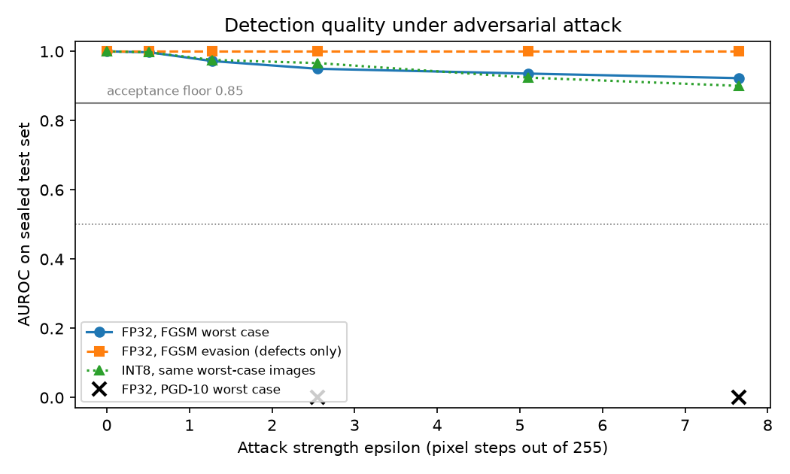
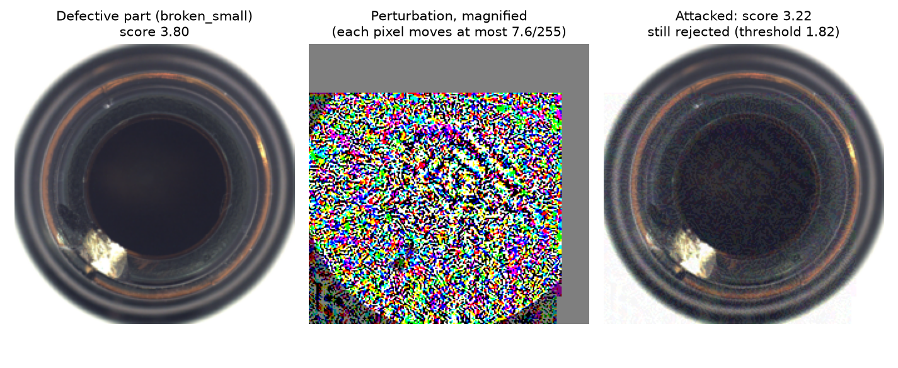

# Readiness report: MedVision bottle anomaly detector

Generated 2026-10-26T18:53:08+00:00 from results evaluated 2026-10-26T18:39:07+00:00. Thresholds frozen 2026-10-26T17:53:39+00:00. Test set opened once, first at 2026-10-26T18:22:04+00:00.

**Recommendation: NO-GO.** 1 pre-set criterion failed. The criteria in config/acceptance.json were written before any model ran and are not changed after the fact.

## Pre-set criteria

| criterion | required | measured | result |
|---|---|---|---|
| Clean test AUROC (FP32) | >= 0.95 | 1 | PASS |
| Clean test AUROC (INT8) | >= 0.95 | 1 | PASS |
| Test recall at frozen threshold (FP32) | >= 0.9 | 1 | PASS |
| Test recall at frozen threshold (INT8) | >= 0.9 | 1 | PASS |
| INT8 AUROC drop versus FP32 | <= 0.02 | 0 | PASS |
| p95 latency, FP32 ONNX end to end (ms) | <= 500 | 125.5 | PASS |
| p95 latency, INT8 ONNX end to end (ms) | <= 500 | 91.3 | PASS |
| Attacked AUROC at eps 0.03 (7.65/255), lower of FGSM and PGD worst case (lower: PGD-10) | >= 0.85 | 0 | FAIL |
| Worst natural-shift AUROC (blur, INT8) | >= 0.85 | 0.9918 | PASS |

## Clean performance (sealed test set: 32 good, 38 defective)

| model | threshold | AUROC | AP | precision | recall | F1 | TP | FP (false alarms) | FN (missed defects) | TN |
|---|---|---|---|---|---|---|---|---|---|---|
| FP32 | 1.81533 | 1 | 1 | 1 | 1 | 1 | 38 | 0 | 0 | 32 |
| INT8 | 1.7915 | 1 | 1 | 1 | 1 | 1 | 38 | 0 | 0 | 32 |

Recall by defect type:

| defect type | n | FP32 recall | INT8 recall |
|---|---|---|---|
| broken_large | 12 | 1.0 | 1.0 |
| broken_small | 13 | 1.0 | 1.0 |
| contamination | 13 | 1.0 | 1.0 |

## FGSM sweep (one step, attack built on FP32 with full model access)

| epsilon | out of 255 | worst case AUROC | worst case AP | worst case recall | worst case false alarms | evasion AUROC | evasion AP | evasion recall | evasion false alarms | INT8 AUROC (same worst-case images) | INT8 recall (same images) |
|---|---|---|---|---|---|---|---|---|---|---|---|
| 0 | 0 | 1.0 | 1.0 | 1.0 | 0 | 1.0 | 1.0 | 1.0 | 0 | 1.0 | 1.0 |
| 0.002 | 0.51 | 0.9975 | 0.998 | 1.0 | 7 | 1.0 | 1.0 | 1.0 | 0 | 0.9975 | 1.0 |
| 0.005 | 1.28 | 0.972 | 0.9792 | 1.0 | 25 | 1.0 | 1.0 | 1.0 | 0 | 0.9753 | 1.0 |
| 0.01 | 2.55 | 0.9498 | 0.96 | 1.0 | 32 | 1.0 | 1.0 | 1.0 | 0 | 0.9663 | 1.0 |
| 0.02 | 5.1 | 0.9359 | 0.9521 | 1.0 | 32 | 1.0 | 1.0 | 1.0 | 0 | 0.9243 | 1.0 |
| 0.03 | 7.65 | 0.9227 | 0.945 | 1.0 | 32 | 1.0 | 1.0 | 1.0 | 0 | 0.9005 | 1.0 |

## PGD (10 steps of eps/4, worst case)

| epsilon | out of 255 | AUROC | AP | recall | false alarms | INT8 AUROC (same images) | INT8 recall (same images) |
|---|---|---|---|---|---|---|---|
| 0.01 | 2.55 | 0.0008 | 0.3479 | 1.0 | 32 | 0.0033 | 0.9737 |
| 0.03 | 7.65 | 0.0 | 0.3479 | 1.0 | 32 | 0.0 | 1.0 |

Naive FGSM that pushes every image towards 'anomalous' at eps 0.03: AUROC 0.9852, AP 0.9915, recall 1, 32 false alarms.

## Natural shift (no attacker)

| condition | what | AUROC FP32 | recall FP32 | false alarms FP32 | AUROC INT8 | recall INT8 | false alarms INT8 |
|---|---|---|---|---|---|---|---|
| darker | pixels x 0.7 | 1.0 | 1.0 | 3 of 32 | 1.0 | 1.0 | 0 of 32 |
| blur | Gaussian blur radius 2 | 0.9951 | 1.0 | 32 of 32 | 0.9918 | 1.0 | 32 of 32 |
| noise | Gaussian noise sd 0.04 | 0.9984 | 1.0 | 32 of 32 | 0.9992 | 1.0 | 32 of 32 |
| jpeg | JPEG quality 30 | 0.9992 | 1.0 | 32 of 32 | 0.9975 | 1.0 | 32 of 32 |

## Efficiency (Intel(R) Core(TM) i7-10875H CPU @ 2.30GHz, 2 threads, one image, 10 warm-ups, 100 timed runs)

| model | clean AUROC | p50 ms | p95 ms | p99 ms | speed-up (p50) | backbone MB | memory bank vectors | memory bank MB |
|---|---|---|---|---|---|---|---|---|
| FP32 | 1 | 104.9 | 125.5 | 145.7 | 1.0 | 11.13 | 1324 | 2.03 |
| INT8 | 1 | 87.7 | 91.3 | 92.4 | 1.2 | 2.85 | 1324 | 2.03 |

## Findings beyond the pre-set criteria

- (a) Under PGD worst case at eps 0.01 (2.55/255) and 0.03 (7.65/255), FP32 recall stays at 1.0 and 1.0 while false alarms reach 32 and 32 of 32 good parts. The failure mode is false alarms on good parts, not missed defects: AUROC collapses to 0.0008 and 0.0 because good parts are pushed above defective ones. One caveat: on the INT8 model the same attacked images give recall 0.9737 at eps 0.01, that is 1 of 38 defects missed.
- (b) Under blur (Gaussian blur radius 2), noise (Gaussian noise sd 0.04), jpeg (JPEG quality 30) the AUROC criterion passes (FP32 AUROC 0.9951, 0.9984, 0.9992; floor 0.85), but the frozen threshold flags every good part (32 of 32, 32 of 32, 32 of 32 false alarms; INT8 32 of 32, 32 of 32, 32 of 32). The scores still rank defects above good parts, but the whole score scale moves, so AUROC was not a sufficient criterion for operational robustness.
- (c) PGD was run only as pgd10_worst_case; PGD in evasion mode (pushing only defective parts towards 'normal') was not tested. One-step FGSM evasion left recall at 1.0 at every epsilon, but whether a multi-step attack can hide defects is unmeasured.

## Numbers for the governance memo

- Recommendation: NO-GO. 8 of 9 pre-set criteria passed; failed: Attacked AUROC at eps 0.03 (7.65/255), lower of FGSM and PGD worst case (lower: PGD-10).
- On the sealed test set (32 good, 38 defective parts, opened once), the detector reached AUROC 1 (FP32) and 1 (INT8), with recall 1 and 1, 0 and 0 missed defects, and 0 and 0 false alarms at the thresholds frozen on validation data.
- Under one-step FGSM worst case at eps 0.03 (7.65/255), AUROC falls from 1 to 0.9227, with 32 of 32 good parts flagged; FGSM evasion at the same strength leaves recall at 1.0.
- FGSM worst case keeps AUROC above the 0.85 floor at every epsilon tested, up to 0.03 (7.65/255).
- A 10-step PGD worst-case attack at eps 0.03 drives AUROC to 0.0 (INT8 on the same images: 0.0): 32 of 32 good parts are flagged while recall stays at 1.0.
- Attack images built on FP32 transfer to INT8: worst-case FGSM at eps 0.03 gives INT8 AUROC 0.9005.
- Natural image changes keep AUROC at or above 0.9951 (FP32), but under blur, noise, jpeg the frozen threshold flags all 32 good parts.
- INT8 shrinks the backbone from 11.13 MB to 2.85 MB and runs at p50 87.7 ms versus 104.9 ms (1.2x), p95 91.3 ms, on an Intel(R) Core(TM) i7-10875H CPU @ 2.30GHz limited to 2 threads.
